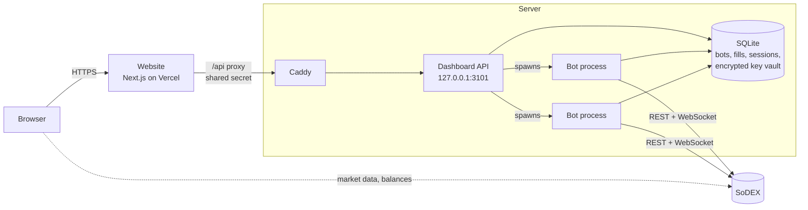

<p align="center">
  
</p>

<h1 align="center">Sodextra</h1>

<p align="center">
  Automated trading bots for <a href="https://sodex.com">SoDEX</a>, running in the cloud and controlled from the browser.
  <br>
  <a href="https://sodextra.xyz"><strong>sodextra.xyz</strong></a>
</p>

---

## Overview

Sodextra runs trading bots on SoDEX around the clock. A user signs in with their wallet, authorizes a trade-only API key, picks a bot and its limits, and follows every order, fill and result live from the dashboard.

- **Non-custodial.** Funds stay in the user's own SoDEX account. Bots sign with a permissioned API key that can trade but cannot withdraw or transfer, and that the user can revoke on sodex.com at any time.
- **Risk limits on every bot.** Exposure, position size, loss limit, open orders and leverage are enforced by the engine, whatever the strategy.
- **Always on.** Each bot runs as its own process on the server and resumes by itself after a server restart.
- **Transparent.** Live PnL, volume, fees and fills for every bot, a plain-language activity log, and a full history of every run.

## Bots

| Bot           | What it does                                                                     |
| ------------- | -------------------------------------------------------------------------------- |
| Maker Volume  | Builds trading volume as a market maker, at maker fees.                          |
| Grid          | Buys low and sells high across a price range, on perps or spot.                  |
| Taker Volume  | Buys and sells at market in quick rounds, so every trade counts as taker volume. |
| Edge          | Trades only where the spread pays more than the fee.                             |
| Spot Edge     | Edge on SoDEX spot markets.                                                      |
| Stock Edge    | Earns the wide spreads of US stock perpetuals while Wall Street is closed.       |
| Funding Carry | Collects the funding paid to shorts, with the price hedged on spot.              |

More detail in [docs/bots.md](docs/bots.md).

> [!NOTE]
> **Source availability.** This repository contains the Sodextra platform: the website, the dashboard API, the bot runner, the trading engine and the SoDEX client. The production strategy modules for Maker Volume, Taker Volume, Edge, Spot Edge, Stock Edge and Funding Carry are proprietary and are not included. The Grid strategy is included as a reference implementation of the strategy interface.

## Architecture



The website never holds keys and never talks to the server directly: its `/api` route forwards each request to the dashboard API with a shared secret, and the API refuses anything else. Every bot is a separate process that talks to SoDEX itself, so a restart of the API or the website never interrupts trading. See [docs/architecture.md](docs/architecture.md).

## Repository layout

```
apps/
  web/            Website and dashboard (Next.js, React, Tailwind, wagmi)
  api/            Dashboard API: sign-in, bot lifecycle, key vault, live views
  cli/            Bot runner: validate, backtest, paper, live, status, stop
packages/
  sodex-client/   SoDEX REST and WebSocket client with EIP-712 signing
  engine-core/    Trading engine: order reconciliation, risk, state, simulation
  strategies/     Strategy implementations (Grid, Probe)
bots/             Example bot files
deploy/           Server provisioning, systemd unit and Caddy configuration
docs/             Architecture, bots, security and deployment
```

## Getting started

**Requirements:** Node.js 22 or later (24 recommended). Dependencies are installed with pnpm through Corepack, which ships with Node.

```bash
corepack pnpm install
cp .env.example .env
```

### Website and dashboard

```bash
npm run api    # dashboard API on 127.0.0.1:3101
npm run web    # website on http://localhost:3100
```

Sign-in is open to the wallets in `SODEXTRA_ALLOWED_ADDRESSES` (or to any wallet with `*`). Bots started from the dashboard run live on the signed-in wallet's own SoDEX account, with a trade-only key created in Setup.

### Bots from the terminal

Every command takes a bot file: a JSON file with the strategy, the market, the strategy's settings and a `risk` block. `bots/example-grid.json` is a small BTC-USD grid; `bots/example-probe.json` keeps a single order far from the market to check the engine end to end.

```bash
npm run bot -- validate bots/example-grid.json             # check against live market data; signs nothing
npm run bot -- backtest bots/example-grid.json --days 7    # simulate on recent 1-minute candles
npm run bot -- paper    bots/example-grid.json             # live prices, simulated orders
npm run bot -- live     bots/example-grid.json --confirm   # real orders, within the risk limits
npm run bot -- status   bots/example-grid.json             # state, open orders, PnL, recent events
npm run bot -- stop     bots/example-grid.json --close     # cancel the bot's orders and close its position
npm run bot -- panic                                       # cancel every Sodextra order on the account
```

Live trading from the terminal uses the API key in `.env` (`SODEX_API_KEY_NAME`, `SODEX_API_KEY_PRIVATE_KEY`): a key created on sodex.com, never a wallet's private key.

### Risk limits

Each bot file has its own `risk` block, enforced by the engine for every strategy:

| Setting         | Limit                                                                                   |
| --------------- | --------------------------------------------------------------------------------------- |
| `maxNotional`   | Exposure in USDC: position plus resting orders that would add to it. Required for live. |
| `maxPosition`   | Position size in the base coin, counting resting orders that would add to it.           |
| `maxLoss`       | Once total PnL reaches −maxLoss USDC, the bot cancels its orders, closes and stops.     |
| `maxOpenOrders` | Orders resting on the book at once.                                                     |
| `maxLeverage`   | Highest leverage the strategy may set.                                                  |

## Development

```bash
npm run check          # typecheck, lint and all tests (no network)
npm run format         # Prettier
npm run smoke:read     # read-only checks against live SoDEX
```

## Security

Wallet sign-in (EIP-4361), HttpOnly session cookies, a strict Content-Security-Policy, an API that listens on localhost only behind a shared-secret proxy, and bot keys sealed with AES-256-GCM that can trade but never withdraw. The full model is in [docs/security.md](docs/security.md).

Please report security issues privately through GitHub's vulnerability reporting for this repository, not in public issues.

## License

Copyright © 2026 Sodextra. All rights reserved. The source code is published for reference only and may not be used, copied, modified or distributed. See [LICENSE](LICENSE).

Trading digital assets carries risk, including the loss of funds. Nothing in this repository is financial advice.
