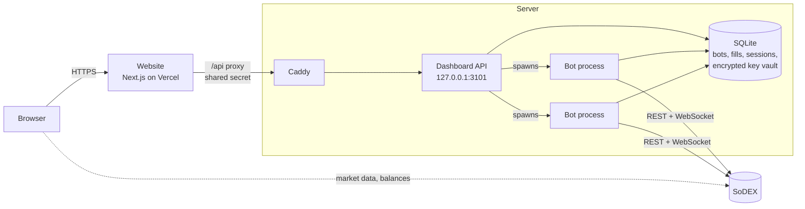

# Architecture

Sodextra is a TypeScript monorepo with three applications and three libraries. The website runs on Vercel; the dashboard API and the bots run on a Linux server.



## Components

| Component     | Code                    | Runs as                                 | Responsibility                                                            |
| ------------- | ----------------------- | --------------------------------------- | ------------------------------------------------------------------------- |
| Website       | `apps/web`              | Vercel (Next.js, React, Tailwind)       | Landing page, dashboard, bot builder, Setup; proxies `/api/*` to the API  |
| Dashboard API | `apps/api`              | systemd service (Node `http`)           | Sign-in, sessions, bot lifecycle, key vault, live views, admin statistics |
| Bot runner    | `apps/cli`              | one process per bot, spawned by the API | Loads a bot file, checks it, runs the engine against SoDEX                |
| Engine        | `packages/engine-core`  | library                                 | Order reconciliation, risk limits, position and PnL, state, simulation    |
| Strategies    | `packages/strategies`   | library                                 | Pure decision logic behind the `Strategy` interface                       |
| SoDEX client  | `packages/sodex-client` | library                                 | REST and WebSocket client, EIP-712 signing, nonces, rate limits           |
| Caddy         | system package          | systemd service                         | TLS for the API's public name; forwards to `127.0.0.1:3101`               |

## Request flow

1. The browser only talks to the website's own origin. `/api/*` is a Next.js route handler that forwards the request to `SODEXTRA_API_URL` with the shared secret (`SODEXTRA_PROXY_SECRET`) and the client's address. The browser never sees the secret, and the session cookie stays first-party.
2. Caddy terminates TLS and forwards to the API, which listens on `127.0.0.1` only and refuses any request without the secret.
3. The API checks the session, the origin and the content type, then reads or changes state in SQLite.
4. Market data and the user's balances are fetched by the browser directly from SoDEX, so they don't spend the server's rate budget.

The dashboard polls: the bot list every 5 seconds and an open bot page every 2 seconds, only while the tab is visible. A bot page response is about 2.5 KB compressed.

## Bot lifecycle

**Start.** The API writes the bot file (`bots/web/<wallet>/<name>.json`), runs the same checks as the CLI (config, market rules, margin across the wallet's bots, key, run spots), picks an egress address with room and spawns `apps/cli` as a detached process. It waits until the bot holds its lock or exits, and shows the bot's own reason when it doesn't start.

**Run.** The bot process keeps one WebSocket to SoDEX for prices and its account's order and trade updates, and a REST connection for orders and checks. Its output goes to `.sodextra/logs/<wallet>-<name>-<mode>.log`.

**Control.** Stop, stop-and-close and resume reach a running bot through the database: the API writes a command row, and the bot polls for it every second. Because bots are detached processes, restarting or updating the API never interrupts them.

**Restart.** With `SODEXTRA_AUTO_RESUME=1`, the API starts again, on boot, every bot that was running when the machine went down. Paused and stopped bots stay as they were. Each resume goes through the normal start checks.

## Engine

A strategy is pure decision logic. It never talks to the exchange: it keeps its own JSON-serializable state and, on each cycle, returns the orders it wants resting on the book.

```ts
interface Strategy<C, S> {
  name: string;
  idPrefix: string; // tags this strategy's client order IDs
  quoting?: boolean; // market makers: arm the exchange dead-man switch
  parseConfig(raw: unknown): C;
  validate(config: C, env: ValidationEnv): ValidationResult;
  initialState(ctx: StrategyContext<C>): S;
  onMarket?(ctx, state, event): void;
  onFill?(ctx, state, fill, order): void;
  onOrderClosed?(ctx, state, order): void;
  desired(ctx, state): DesiredOrder[];
}
```

The engine owns everything else:

- **Reconciliation.** It diffs the desired orders against the bot's open orders and places, replaces or cancels the difference, with retries, rate limits and SoDEX's price and size rules. Every 30 seconds it reconciles against the exchange's view of orders, position and trades.
- **Risk.** Every order is checked against the bot's `risk` block (exposure, position, open orders, leverage). Reaching `maxLoss` cancels the bot's orders, closes its position and stops it.
- **Safety.** When prices stop arriving, the bot stops quoting and reconnects its feed. A position that differs from the exchange's for more than 30 seconds pauses the bot until they agree again. Quoting strategies keep SoDEX's dead-man switch armed 60 seconds ahead, so their orders are cancelled if the process dies.
- **Accounting.** Position, realized and unrealized PnL, fees and volume are tracked from the bot's own fills. A PnL sample is kept every minute for the dashboard's charts.
- **State.** Bots, orders, fills, events, runs and strategy state live in SQLite (`node:sqlite`, WAL), so a bot resumes exactly where it stopped.
- **Modes.** The same strategy code runs live, in paper mode (live prices, simulated fills) and in candle backtests.

Client order IDs carry the strategy's prefix and the bot's ID, so each bot recognizes its own orders on a shared account.

## Rate limits and capacity

SoDEX limits REST weight per IP, and WebSocket connections and distinct accounts per IP. Each bot uses its own connection and its own account feed, so the API places bots across the server's public addresses (`SODEXTRA_EGRESS_IPS`), keeping one person's bots on the same address. The bot sends all its SoDEX traffic, REST and WebSocket, from the address it was given. Server-wide limits (`SODEXTRA_MAX_RUNNING_BOTS`, `SODEXTRA_RUN_SPOTS`) default to ten per address.

## Data

| Path                    | Contents                                       |
| ----------------------- | ---------------------------------------------- |
| `.sodextra/sodextra.db` | Bots, orders, fills, events, runs, PnL samples |
| `.sodextra/auth.db`     | Sign-in sessions (SHA-256 hashes only)         |
| `.sodextra/vault.db`    | Bot keys, sealed with AES-256-GCM              |
| `.sodextra/logs/`       | Bot output                                     |
| `.sodextra/locks/`      | Which process runs which bot                   |
| `bots/web/`             | Bot files written by the dashboard             |

All of these are created at runtime and excluded from version control.
